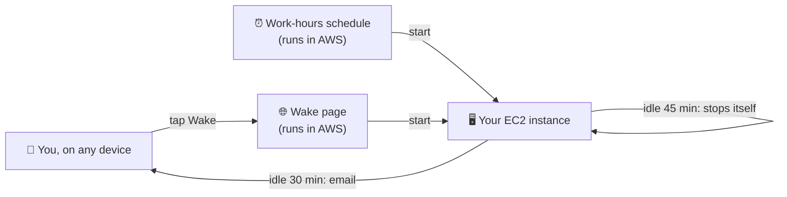

# EC2 Idle Stop and Wake

**Pay for your cloud computer only while you use it.**

Your EC2 instance (a computer you rent from AWS) turns itself off when you stop working, and it turns back on with one tap from any browser, phone or terminal. You set it up once, and nothing has to keep running on your own computer.

   

> [!TIP]
> **In short**
> - **Stops by itself.** After 45 quiet minutes, with one warning email at 30 and one "stopped" email that includes your wake link.
> - **Wakes from anywhere.** A private web page, a one-line terminal command, or a daily schedule.
> - **Saves money.** About two-thirds less than leaving it on all the time, for a typical weekday routine.

---

## ☀️ A normal day

| When | What happens | What you do |
|---|---|---|
| 🌅 Morning | The instance starts, from your schedule or when you tap **Wake** on your bookmarked page. | Open your editor or terminal and connect as usual. |
| 💻 While working | Your open connection keeps it running. | Nothing. |
| ✉️ You finish | 30 minutes later you get **one** email: "will stop in 15 minutes". | Nothing, or reconnect to keep it running. |
| 💤 45 minutes later | It stops, and you get **one** "has stopped" email with your wake page link. Your files stay saved on its disk. | Nothing. You only pay for storage now. Tap the link when you need it again. |

---

## ✨ What you get

| | Feature | What it means for you |
|---|---|---|
| 💤 | **Stops by itself** | A tiny timer inside the instance checks every minute and stops it after 45 idle minutes. It's lightweight enough for the smallest instance and stays out of the way of heavy workloads. No other machine is involved. |
| 🌐 | **Wake page** | A private link to open on any browser or phone. Tap **Wake**, and it shows when the instance is ready and the command to connect. |
| ⌨️ | **Wake from a terminal or code** | One command wakes the instance, waits until it's ready, and prints the progress. Scripts and AI agents can use it too. |
| ⏰ | **Work-hours start** (optional) | It starts on a timetable you choose, for example 9:00 on weekdays. |
| 🛡️ | **Protects your work** | Open connections (SSH, VS Code, Cursor and others) keep it awake. You can also keep it awake for long jobs that run after you disconnect. |
| 🧯 | **Safe by design** | Random internet traffic can't keep it awake, a broken email can't stop it from stopping, and a backup alarm tells you if anything goes wrong. |
| 💾 | **Nothing is lost** | Stopping is like shutting a laptop lid. Your files, programs and settings stay on the disk. |

This is what the terminal wake looks like:

```text
$ curl -d key=<WAKE_KEY> -d action=wake <WAKE_URL>
state: running
ready: yes
ssh: ssh ubuntu@3.25.10.20
progress:
    0s  stopped
    2s  start requested, now pending
   24s  running
   26s  ready
```

---

## 📬 Emails you'll get

Never more than these, so your inbox stays quiet:

| Email | When | How often |
|---|---|---|
| **"… will stop in 15 minutes"** | After 30 minutes with no activity | **At most once per hour**, even if you come and go |
| **"… has stopped"** | Right after it stops, with your **wake page link** and a ready-to-copy wake command | **Once per stop** |
| **"Idle stop is set up"** | When you first install, or change the email topic | Once |
| **AWS "ALARM"** (backup alarm) | After hours of quiet running, for example an editor left open. You may also get one about 20 minutes after first setup if the instance was already idle. That's normal. | Once per incident |

Email trouble never blocks the stop, so a broken email setup can't leave the instance running and costing money.

---

## 🚀 Get started

Choose one way. All three end with the same setup.

| Way | Good for | Time |
|---|---|---|
| 🤖 **[Let an AI agent do it](#-let-an-ai-agent-do-it)** | You use Claude Code, Codex, Cursor or a similar assistant. It asks before every step. | About 10 min |
| 🧭 **[Follow the guide yourself](SETUP.md)** | You'd rather click through the AWS console. Every step is explained. | About 15 min |
| 🔍 **[Just check my account first](SETUP.md#step-0-plan-your-setup)** | You want to see what you have before deciding. It changes nothing. | About 2 min |

### 🤖 Let an AI agent do it

Copy this into your AI assistant:

```text
Set up EC2 idle stop and wake for me by following AGENT_SETUP.md at https://github.com/manojvermamv/ec2-idle-stop-wake. Ask my permission before any AWS discovery and before every change.
```

The assistant will:
1. Ask you a few questions.
2. Look at your AWS account, read-only and only if you say yes.
3. Show you a plan with the costs.
4. Change things only after you approve each step.

To only look and change nothing, use:

```text
Follow AGENT_SETUP.md at https://github.com/manojvermamv/ec2-idle-stop-wake up to the plan step only. Run read-only discovery if I agree, and change nothing.
```

> [!NOTE]
> Your **wake key**, the password for your wake page, never has to be shared with the assistant. You create it yourself.

---

## 🧭 How it works



- ☁️ **Waking** happens in AWS, so it works even when your computer is off.
- 💤 **Stopping** happens inside the instance itself.
- 📖 **Details:** the full picture, with the reasons behind each choice, is in **[WORKFLOW.md](WORKFLOW.md)**.

---

## 💰 Costs and savings

AWS charges **nothing extra for stopping and starting**. You pay the normal rates for what runs.

| What | Cost |
|---|---|
| 🖥️ **Computer time** | Only while running, billed per second with a one-minute minimum per start. |
| ⏳ **Wind-down time** | About 45 minutes after you finish, roughly US$0.09 in the example below. |
| 💾 **Disk storage** | All month, even while stopped. |
| 🌍 **Fixed IP address** (optional) | About US$3.65/month. Without one, the address changes at each start and the wake page shows the new one. |
| ✉️ **Email, wake page, schedule, alarm** | Expected US$0. Normal use fits inside the AWS free allowances. |

<details>
<summary><b>Price details and links</b></summary>

| Item | Free allowance or price |
|---|---|
| EC2 compute | Per second, one-minute minimum per start. Nothing while stopped. [EC2 billing](https://docs.aws.amazon.com/AWSEC2/latest/UserGuide/how-ec2-instance-stop-start-works.html) |
| EBS disk | Charged all month. [EBS pricing](https://aws.amazon.com/ebs/pricing/) |
| Public IPv4 | An Elastic IP is charged every hour. An auto-assigned IP is charged only while running. [VPC pricing](https://aws.amazon.com/vpc/pricing/) |
| SNS email | The first 1,000 emails each month are free. [SNS pricing](https://aws.amazon.com/sns/pricing/) |
| Lambda wake page | The first 1 million requests and 400,000 GB-seconds each month are free. [Lambda pricing](https://aws.amazon.com/lambda/pricing/) |
| EventBridge Scheduler | The first 14 million runs each month are free. [EventBridge pricing](https://aws.amazon.com/eventbridge/pricing/) |
| CloudWatch alarm | The first 10 alarms are free. [CloudWatch pricing](https://aws.amazon.com/cloudwatch/pricing/) |
| CloudFormation | No charge. |

</details>

### Example: `m7i-flex.large` with US$200 in credits

| How you use it | Per month | US$200 lasts about |
|---|---:|---|
| 🔴 Left on all the time | **US$95.83** | 2 months |
| 🟡 8 hours every day, then auto-stop | **US$40.31** | 5 months |
| 🟢 8 hours on weekdays, then auto-stop | **US$31.49** | 6 months, the full [AWS Free plan](https://aws.amazon.com/free/free-tier-faqs/) period |

The example assumes:
- US$0.1197 per hour.
- US$8.45/month for a 50 GiB disk and a fixed IP.
- 45 wind-down minutes per session.

Your Region's prices may differ. [EC2 pricing](https://aws.amazon.com/ec2/pricing/on-demand/)

> [!IMPORTANT]
> ⚠️ **What uses extra credit:**
> - An editor window left open, because it counts as working.
> - Long jobs you've marked as "keep awake".
> - The 45-minute wind-down after each session.
>
> Run one [full test](TESTING.md#-level-6-live-acceptance-cycle) before relying on the savings.

---

## 🔐 Is it safe?

- 🔑 **The wake page needs your wake key.** Even someone with both the link and the key can only *start* the instance. They can't log in, read files or stop it, and it turns itself off again when idle.
- 🔒 **AWS never stores your key,** only a scrambled fingerprint of it (a SHA-256 hash).
- 🧩 **Each part has the smallest possible permission.** The wake page can only start this one instance, and the instance can only stop itself.
- 🤖 **AI agents need your yes for every change.** Reading the docs gives them no permission. See the [agent rules](AGENT_SETUP.md#-step-0-rules-for-the-agent).
- 🚪 **Tip:** limit who can reach your instance's SSH port to your own IP address. The discovery check warns you if it's open to everyone.

---

## ✅ What you need

| You need | Notes |
|---|---|
| 🖥️ An EC2 instance with an **EBS disk** | Most instances have one. Ubuntu 20.04+, Debian 11+ or Amazon Linux 2023. |
| ☁️ Access to the **AWS console** | Its built-in terminal, **CloudShell**, does the AWS work, so you install nothing on your computer. |
| 🔐 A way to connect over **SSH** | The way you connect today is fine. |

🚫 **Not supported:** Windows instances, instance-store disks, and one-time Spot Instances. None of these can be stopped and restarted.

<details>
<summary><b>Key terms</b></summary>

| Term | Meaning |
|---|---|
| **EC2 instance** | A computer you rent from AWS. |
| **Stop vs terminate** | *Stop* is like shutting a laptop, and your disk is kept. *Terminate* deletes the instance. This project only ever stops. |
| **EBS** | The instance's disk. It keeps your files while the instance is stopped. |
| **Elastic IP** | A fixed internet address. Optional. |
| **CloudShell** | A terminal inside the AWS console that's already signed in. |
| **CloudFormation stack** | A bundle of AWS pieces created and removed together from one file (`src/ec2-idle-stack.yaml`). |
| **Wake key** | The password for your wake page. |
| **SSH** | The usual way to connect to a Linux machine. VS Code and Cursor use it too. |
| **Region** | The AWS location where your instance lives, for example Sydney. |

</details>

---

## 📚 Guides

| | Guide | Read it when |
|---|---|---|
| 🧭 | [SETUP.md](SETUP.md) | You set it up yourself, once. |
| 🤖 | [AGENT_SETUP.md](AGENT_SETUP.md) | An AI assistant sets it up for you. |
| 📖 | [RUNBOOK.md](RUNBOOK.md) | Everyday use, waking from a terminal, fixing problems, removing it. |
| 🧪 | [TESTING.md](TESTING.md) | You want proof that it works. |
| 🧠 | [WORKFLOW.md](WORKFLOW.md) | You're curious how and why it works. |

<details>
<summary><b>Files in <code>src/</code></b></summary>

| File | Runs on | Purpose |
|---|---|---|
| [ec2-idle-stack.yaml](src/ec2-idle-stack.yaml) | ☁️ AWS CloudFormation | Wake page, permissions, email, optional schedule and backup alarm |
| [discover.sh](src/discover.sh) | ☁️ AWS CloudShell | Read-only check of your account, with suggested settings |
| [install_guest.sh](src/install_guest.sh) | 🖥️ Your EC2 instance | One-time install, or uninstall, of the idle timer |
| [ec2_idle.py](src/ec2_idle.py), [ec2-idle.service](src/ec2-idle.service), [ec2-idle.timer](src/ec2-idle.timer), [ec2-idle.conf](src/ec2-idle.conf) | 🖥️ Your EC2 instance | Idle timer program and settings |
| [wake_ec2.py](src/wake_ec2.py) | ☁️ AWS Lambda | Wake page program (built into the stack file) |
| [ec2_up.py](src/ec2_up.py) | 💻 Your computer, optional | Lets `ssh` wake the instance by itself |
| [test_workflow.py](src/test_workflow.py), [verify_guest.sh](src/verify_guest.sh), [sync_template.py](src/sync_template.py) | 🧪 Anywhere | Tests and maintenance |

</details>

---

<p align="center"><code>stop when idle · wake from anywhere · pay for what you use</code></p>
