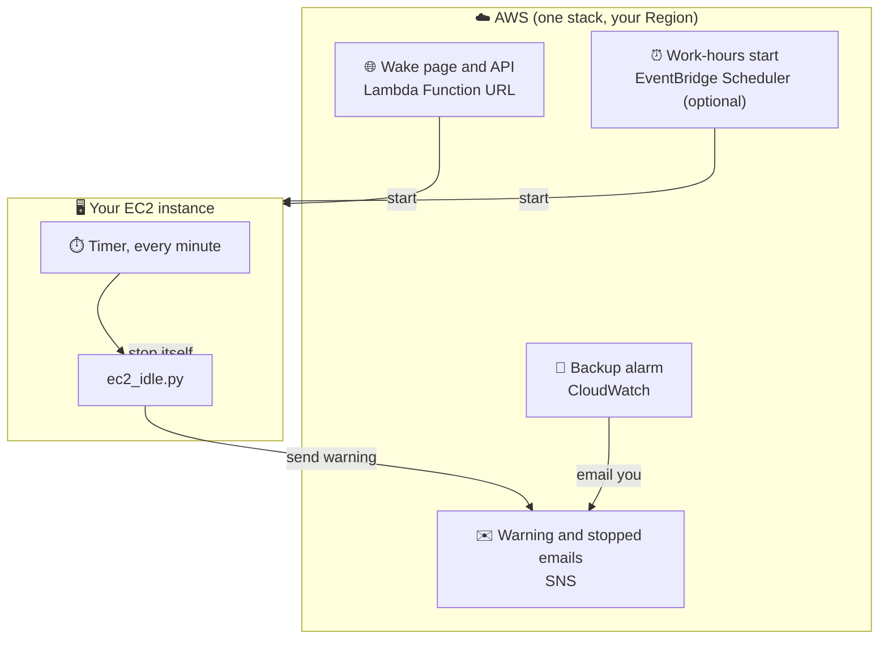
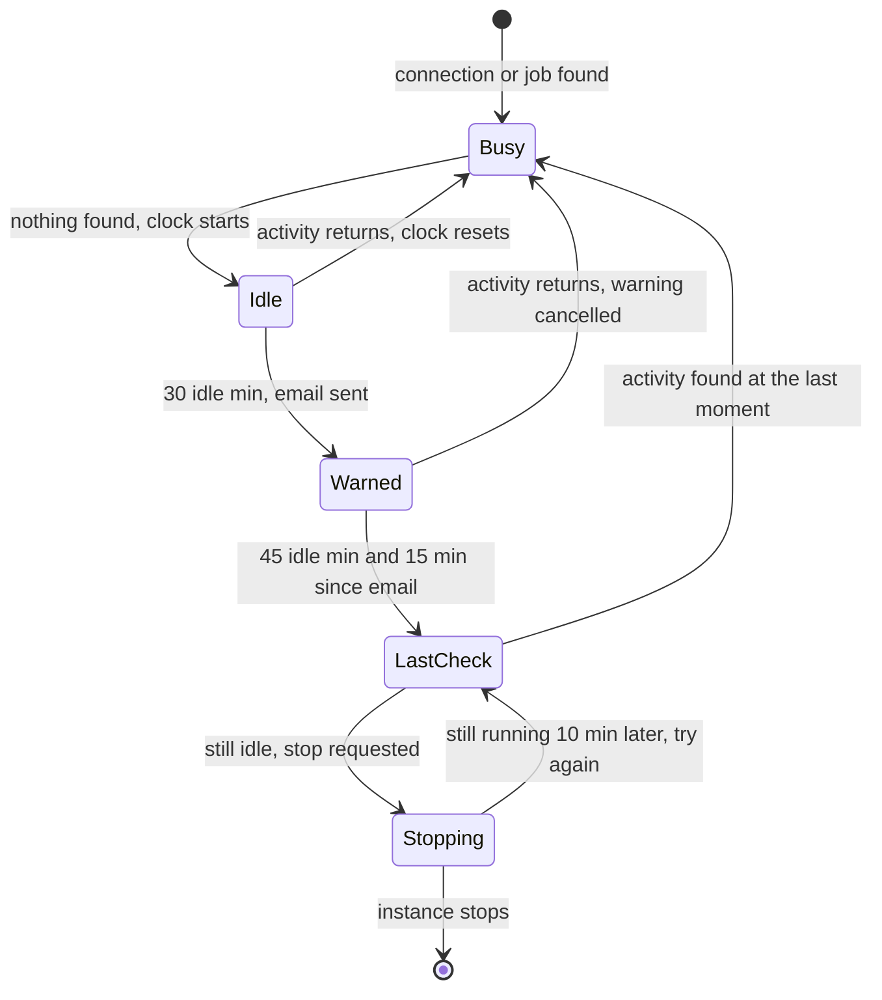
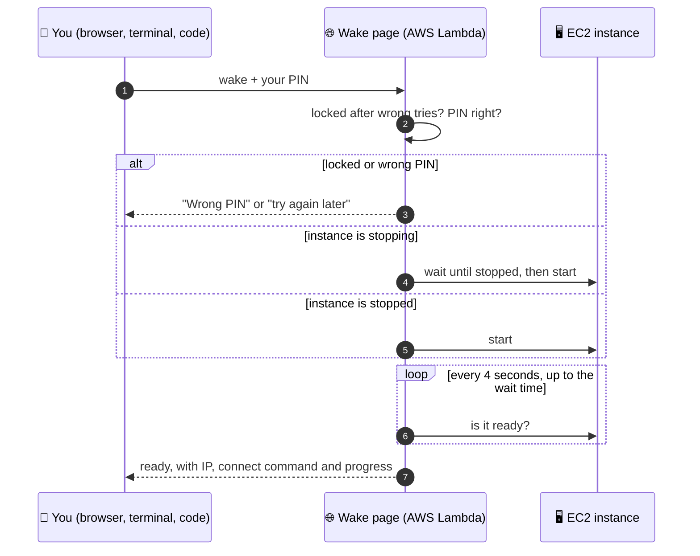

# 🧠 How it works

[README](README.md) · [Setup](SETUP.md) · [Agent setup](AGENT_SETUP.md) · [Runbook](RUNBOOK.md) · [Testing](TESTING.md)

> [!TIP]
> **In short**
> - Two small helpers do all the work:
>   - one **inside the instance**, which stops it when idle;
>   - one **in AWS**, which starts it when you ask.
> - Neither needs your computer.
> - You don't need this page to use the project. It explains the idea and the reasons behind each choice.

---

## 🎯 Goals

| Goal | How it's met |
|---|---|
| Set up once, then forget it | One AWS stack file plus one installer run on the instance. |
| Nothing runs on your computer | Waking runs in AWS. Stopping runs inside the instance. |
| Never cut off real work | Only real connections and declared long jobs count, and it checks once more right before stopping. |
| Never waste money silently | A broken email can't stop the shutdown, failed stops are retried, and a backup alarm watches. |
| Usable from anywhere | Browser, phone, any terminal, code or AI agent, with no AWS login and nothing to install. |

---

## 🧩 The pieces

| Piece | Lives in | Runs when | Allowed to |
|---|---|---|---|
| Idle timer (`ec2_idle.py`) | The instance | Every minute, starting 5 minutes after boot | Stop **its own** instance and send **its own** emails (one warning, one "stopped") |
| Wake page (`wake_ec2.py`) | AWS Lambda | You open it, or call it with your PIN | Look up instances, and start **this** instance |
| Work-hours start | AWS EventBridge Scheduler | On your timetable | Start **this** instance |
| Backup alarm | AWS CloudWatch | CPU stays low for hours while running | Email you (or, if you opt in, stop the instance) |
| SSH helper (`ec2_up.py`) | Your computer, optional | You run `ssh` | Call the wake page, then connect |

---

## 💤 How it decides to stop

Once a minute, the timer asks: *is anyone or anything using this instance?*

**Safety rules**
- ❓ **When unsure, it stays on.** Any error in a check restarts the idle clock instead of moving toward a stop.
- ⏱️ **Long gaps restart the clock.** Checks delayed by a busy host still count. Two checks more than 5 minutes apart (after a pause, for example) start the count over.
- ✉️ **You always get the full warning time.** The 15 minutes count from when the email was actually sent.
- 🧯 **Email trouble can't block the stop.** After 3 failed emails in a row, it stops without one. The "stopped" email is sent after the stop request, so it can never delay it.
- 📬 **Quiet inbox.** At most one warning email per hour, even if you connect and disconnect several times, and one "stopped" email per stop.
- 🔁 **Every boot starts fresh.** The idle clock is kept in memory only.

### What counts as "in use"

| Keeps it on ✅ | Doesn't keep it on ❌ |
|---|---|
| A logged-in SSH connection, including VS Code and Cursor | Random internet traffic hitting the SSH port, which never logs in |
| EC2 Instance Connect and Session Manager sessions | An editor window you already closed |
| Anything your long-job check reports as busy | Web apps used without an SSH login |
| | Background jobs you didn't add to the long-job check |

---

## 🪶 Light on the host

The timer is built to be invisible, even on the smallest instance or one that's busy with heavy work.

| What | How |
|---|---|
| **Almost no work most minutes** | A normal check starts no other programs. It reads login sessions through systemd's own library and Session Manager sessions from `/proc`, then exits. |
| **Network code only when needed** | The AWS signing and HTTPS code loads only when an email or a stop is due. |
| **Fast start** | Python runs with `-I -S` (isolated, without site packages). |
| **Low priority** | It runs at `Nice=10` with `CPUWeight=20` and low IO priority, so your workloads always come first. |
| **Small, capped memory** | It uses about 10 MB, with a soft limit of 48 MB and a hard limit of 96 MB. |
| **Copes with a busy host** | Runs delayed by up to 5 minutes still count toward the idle time. Only a longer pause restarts the clock. |
| **Fails safe** | If a check can't finish, for example under memory pressure, the instance simply stays on. It never stops by mistake. |

---

## 🌐 How waking works

| You use | You get | It waits |
|---|---|---|
| A browser | The wake page, which shows each step as it happens | The page keeps checking by itself |
| A terminal (`curl -d …`) | Easy-to-read text | Up to 2 minutes |
| Code (JSON) | JSON | Only if you ask, up to 150 seconds |
| `curl <WAKE_URL>` with nothing else | Instructions | – |
| The schedule | Starts the instance directly | – |

---

## 💡 Why it's built this way

| Choice | Why | Not chosen |
|---|---|---|
| A public link protected by a short PIN | It works on any device with no AWS login. The worst a stranger with the PIN can do is start it, and it stops again by itself. | AWS-signed requests, which need AWS tools and logins that expire. |
| 5 wrong tries lock the page for 15 minutes | A short, easy PIN can't be guessed in practice. A tiny table counts the tries, and if it can't, the page stays closed. | A long random key, which is a pain to type and move around. |
| The PIN is stored as a hidden stack setting | Hashing a short PIN adds no real protection, and setup stays one simple step. | A hash you had to compute by hand. |
| The timer talks to AWS directly | Nothing extra to install on the instance. | Installing the AWS command-line tools. |
| Only logged-in sessions count | Internet scanners can't keep it awake. | Counting any network connection. |
| The backup alarm only emails by default | Quiet editing uses little CPU, so an automatic stop could cut you off. | Stopping automatically on low CPU. |
| The instance finds its own ID | Nothing to type wrong, and it can only ever stop itself. | Typing the ID into a settings file. |
| Terminal wakes wait before replying | One command gives you a final answer. | Live streaming, which this Lambda runtime can't do. |
| No "wake on SSH attempt" | AWS only notices such attempts minutes later, and not reliably. | Watching network logs. |

---

## 🚧 Limits

- 1️⃣ **One instance per stack.** For another instance, create another stack with a different name.
- ⏳ **Terminal progress arrives at the end** of the wait. Repeat the status command to follow along live.
- 🧯 **The backup alarm only sees CPU,** not your connections. That's why it emails rather than stops.
- 🌍 **The IP address changes** at each start unless you choose a fixed IP.
- 🐧 **Linux only.** Windows instances aren't supported.
